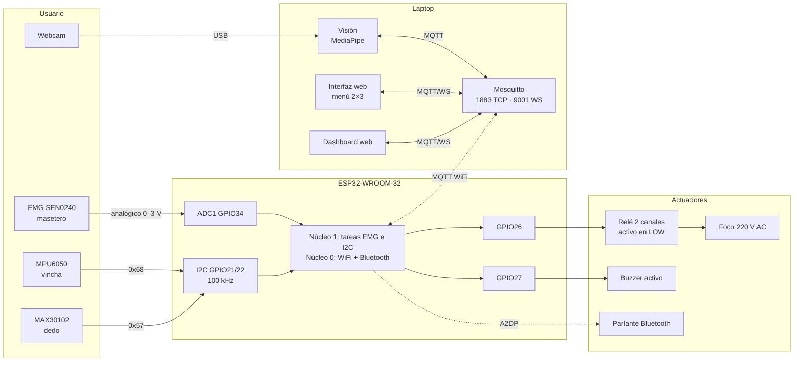
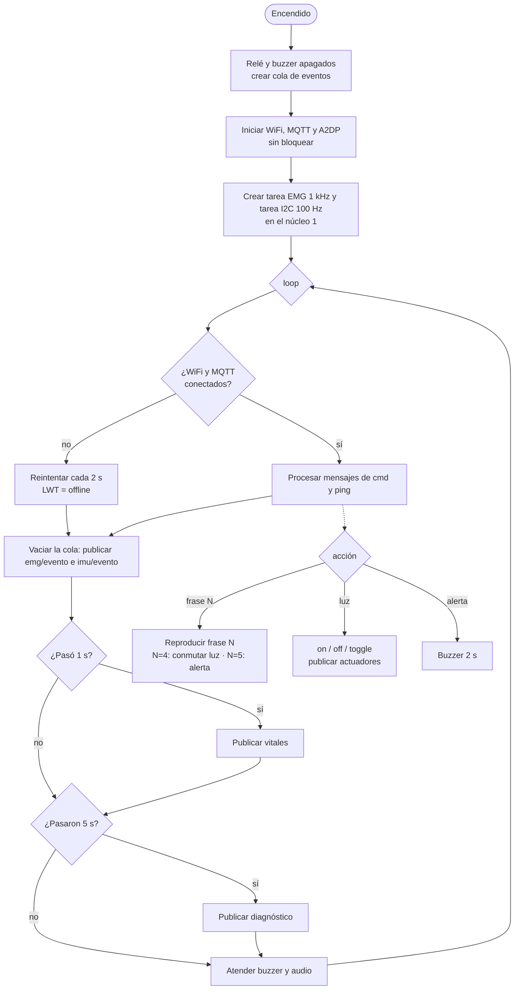
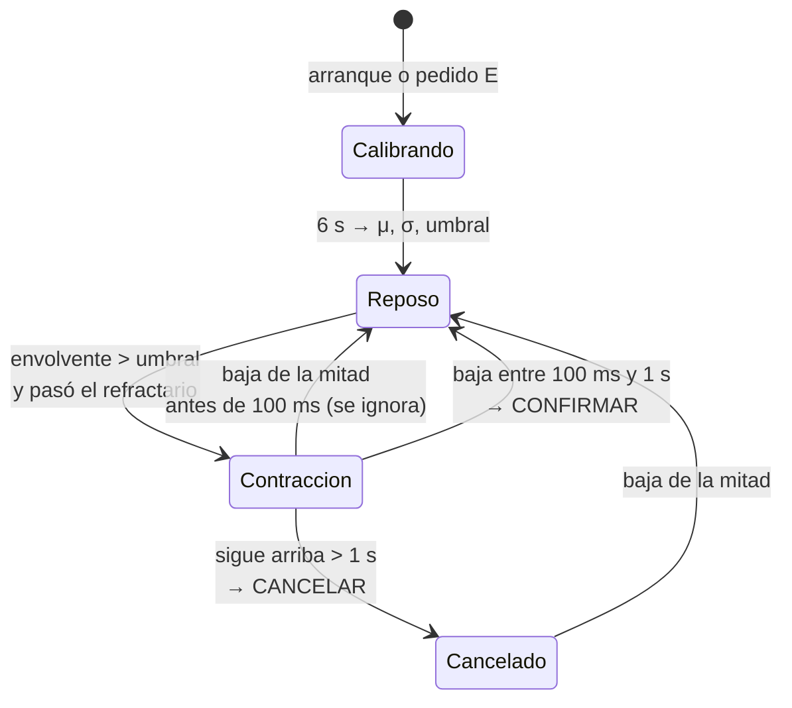

# Contexto para redactar el informe P2

**Proyecto:** Sistema IoT de comunicación asistiva mediante gestos y mirada (CS5055 Internet of Things, UTEC 2026-2).
**Equipo:** Nicolas Castaneda, Pedro Mori, Angel Tito, Luis Torres.
**Entrega:** viernes 13 de noviembre de 2026, 23:59 (semana 14). Un solo integrante sube el PDF por todo el grupo.

Este documento reúne lo necesario para escribir el P2 sin tener que leer todo el repositorio: qué pide el curso, qué cambió desde el perfil (P1), los datos medidos, las figuras disponibles y lo que todavía falta conseguir. Cada dato tiene su fuente en el repo, para poder verificarlo.

---

## 0. Qué pide el curso

- Informe en **LaTeX**, entregado como **un solo PDF**.
- **Turnitin < 20 %** de similitud; si se pasa, no se evalúa.
- Es la versión **consolidada, corregida y mejorada del P1**, más todo el desarrollo y la implementación del prototipo.

**Secciones obligatorias, en este orden:**

1. Título del proyecto.
2. Introducción, Problemática y Marco Teórico: lo del P1, consolidado. Solo la teoría necesaria para entender el informe.
3. Estado del Arte: análisis **extendido** de trabajos de los **últimos 7 años** (2019 en adelante).
4. Metodología y Desarrollo del Proyecto: planteamiento del sistema, con un diagrama de bloques o una representación gráfica. Debe incluir **al menos una figura explicativa basada en el Estado del Arte**.
5. Implementación, con evidencias reales:
   - lógica de programación (**diagrama de flujo**);
   - interconexiones entre componentes (**diagrama de bloques**);
   - **fotos** del armado del prototipo, cada una con su explicación.
6. Análisis de Resultados: hallazgos con figuras y tablas. **Obligatorio:** al menos una figura de resultados **original** (generada por nosotros) y explicada.
7. Descripción del Mercado: segmento y posible modelo de negocio, **máximo dos párrafos**. Aquí va el **enlace al video publicitario**.
8. Conclusiones y Recomendaciones.
9. Referencias en **formato IEEE estricto y uniforme**.

### Punto de partida

- El P1 está en `IOT/Proyecto/IOT_PROYECTO.pdf`, fuera de este repo. Tiene formato IEEE de conferencia en español, 21 referencias, 4 tablas y el diagrama de bloques (Figura 1). Lo más práctico es partir de su fuente `.tex`.
- **Turnitin:** si el P1 pasó por Turnitin, copiar sus párrafos tal cual puede contar como similitud. Conviene reescribir con otras palabras lo que se reutilice, sobre todo la introducción, la problemática y el marco teórico.
- Hay que **corregir lo que el P1 dijo y ya no es cierto** (sección 2 de este documento). El enunciado lo pide expresamente ("corregida").

---

## 1. Resumen del proyecto (para el título, el resumen y la introducción)

Un prototipo de bajo costo para que una persona con movilidad reducida severa y sin habla (ELA, secuelas de ACV, lesión medular alta) pueda:

1. **Elegir una de 6 frases** en una cuadrícula de 2 × 3, moviendo la **mirada** (webcam + MediaPipe) o **inclinando la cabeza** (MPU6050 en una vincha).
2. **Confirmar** apretando la **mandíbula** (EMG sobre el masetero). Un apretón de más de 1 s **cancela**.
3. Escuchar la frase en un **parlante Bluetooth** (A2DP desde el ESP32), **encender una luz** (relé) o **llamar al cuidador** (buzzer).
4. Mostrar al cuidador el **pulso y la SpO₂** (MAX30102) en un dashboard, con alarma fuera de rango, junto con las métricas de desempeño del sistema.

| ID | Frase | Acción adicional |
|---|---|---|
| 1 | Tengo hambre | — |
| 2 | Hola | — |
| 3 | Tengo sed | — |
| 4 | Enciende la luz | Conmuta el relé |
| 5 | Llamar al cuidador | Activa el buzzer 2 s |
| 6 | Siento dolor | — |

**Requisitos del curso que se cumplen:** 3 sensores en el microcontrolador (EMG, MPU6050, MAX30102), 3 actuadores (parlante BT, relé, buzzer), comunicación inalámbrica (WiFi/MQTT y Bluetooth A2DP), un dashboard con procesamiento y un enclosure (pendiente, ver sección 9). La webcam **no cuenta** como sensor IoT.

---

## 2. Qué cambió desde el P1 (corregir en el informe)

| Tema | Lo que dijo el P1 | Lo que se implementó | Por qué |
|---|---|---|---|
| Sensor EMG | Muscle Sensor (placa roja): ±9 V con 2 baterías, divisor 20k/10k, envolvente ya rectificada, 500 Hz, electrodos Ag/AgCl desechables | **DFRobot Gravity OYMotion SEN0240**: 3,3 V desde el ESP32, sin baterías ni divisor. Entrega la señal **sin rectificar**, centrada en ~1,5 V. Se muestrea a **1 kHz** y el ESP32 filtra, rectifica y saca la envolvente. Electrodo **seco y reutilizable** | Fue el sensor que se compró. Simplifica la alimentación y elimina las baterías |
| Ruido de la red | No se mencionaba | **Filtro notch digital en 60, 120 y 180 Hz** (biquad, RBJ Audio EQ Cookbook) antes de rectificar | En el salón, el 94 % de la señal en reposo era ruido de 60 Hz (sección 6.3) |
| Detección EMG | Umbral μ + 3σ, duración mínima de 100 ms, refractario de 700 ms | Lo mismo, más: umbral mínimo de μ + 50 cuentas, **histéresis** (la contracción termina al bajar a la mitad entre μ y el umbral), **cancelar** con más de 1 s y aviso de saturación del ADC | Sin histéresis, los apretones largos se partían en dos y daban "confirmar" en vez de "cancelar" |
| MPU6050 | Se suponía un MPU6050 genuino | Es un **clon** (`WHO_AM_I = 0x74`); la librería de Adafruit lo rechaza y se leen los registros directamente. Se calibra la **posición neutra** (2 s) al arrancar. Umbral de **15°** con **histéresis a 7°**, eje dominante y refractario de 500 ms. Opción `IMU_FRENTE` para montarlo vertical en la frente | El clon tiene un desvío de ~10° / −14° en reposo |
| Pulso (MAX30102) | Frecuencia cardiaca por intervalo entre picos; SpO₂ por la razón R | **Algoritmo propio** para el pulso: quita la componente lenta, aplica un pasa bajos, detecta máximos de −IR con umbral adaptable y toma la mediana de 6 intervalos. La **SpO₂** sale del algoritmo de Maxim (ventana de 4 s). La FIFO se lee directo, a 25 muestras/s, con brillo 30 | El algoritmo de Maxim daba 107–166 BPM con un pulso real de ~79: contaba la muesca dícrota como otro latido |
| Visión | MediaPipe **Face Mesh**: iris respecto de las comisuras, escalado a la pantalla | MediaPipe **Face Landmarker** (Tasks API; Face Mesh ya no existe en mediapipe 1.x). **20 rasgos**: iris de cada ojo, apertura de los párpados, 8 *blendshapes* de mirada y **pose 3D de la cabeza**. **Regresión ridge** con calibración de 10 puntos. El modelo se elige entre **48 variantes** por **validación cruzada dejando un punto fuera**. Filtro **One Euro** e histéresis entre casillas | Mayor precisión y tolerancia a pequeños movimientos de la cabeza |
| Relé | Módulo de 1 canal; foco LED de 12 V | Primero un JQC3F-05VDC-C, que no se apagaba con lógica de 3,3 V. Se **reemplazó** (2026-11-08) por un **módulo de 2 canales**: VCC a 5 V, IN directo a GPIO26, **activo en LOW**. **Carga: un foco de 220 V AC**, con un conductor cortado entre COM y NO | El módulo de 1 canal quedaba siempre encendido. El foco de 220 V muestra el control de una carga real de la casa (ver la nota de seguridad en 5.1) |
| Buzzer | Buzzer de 5 V con transistor 2N2222 | Buzzer activo **directo a GPIO27**, sin transistor | Suena bien a 3,3 V |
| Parlante | Genérico | Probado con Sony ULT WEAR y Xiaomi Sound Pocket. Se busca **por parte del nombre** y se reconecta solo | — |
| Tareas | "Dos núcleos con FreeRTOS" | Núcleo 1: tarea EMG a 1 kHz (prioridad 5) y tarea I2C a 100 Hz (prioridad 4). WiFi y BT en el núcleo 0. Los eventos llegan a `loop()` por una **cola** | — |
| Topics | 5 topics | **15**: se suman ping/pong (latencia), actuadores, diagnóstico, visión e interfaz (sección 5.4) | — |
| QoS | "Los eventos y comandos usan QoS 1" | El ESP32 **publica en QoS 0**, porque la librería PubSubClient no publica en QoS 1; **sí se suscribe** a `cmd` en QoS 1. La interfaz web publica en QoS 1 | Limitación de la librería: decirlo con honestidad |
| Interfaz y dashboard | Python | **Páginas web** (HTML + JS) con un cliente **MQTT 3.1.1 sobre WebSocket** escrito por el equipo, sin librerías externas. Mosquitto escucha en el 1883 (TCP) y en el 9001 (WebSocket) | Corren en cualquier navegador, incluido el celular del cuidador |
| Accidentales | "Activaciones accidentales por minuto" | **Por cada 5 min** en reposo (meta ≤ 1) | Coherente con la meta del P1 |

Las **metas** del P1 se mantienen: aciertos ≥ 90 %, tiempo de selección ≤ 5 s, ≤ 1 activación accidental cada 5 min y latencia MQTT < 300 ms.

---

## 3. Estado del arte

El P1 revisó 8 trabajos, todos de 2024 a 2026, así que entran en la ventana de 7 años. El P2 pide un análisis **extendido**. Lo que ya está:

| Ref. P1 | Trabajo | Qué aporta | Relación con el proyecto |
|---|---|---|---|
| [8] | Gonzalez-Maldonado et al., 2026 | Webcam + Face Mesh, *dwell-click* de 3 s, ~90 USD; mediana 4,5/5 con 4 usuarios | No midieron aciertos ni clics accidentales → nuestro dashboard sí. El EMG reemplaza al *dwell* |
| [15] | Chhimpa et al., 2024 | Mirada sin calibración, < 100 USD | El cursor continuo exige precisión → usamos 6 regiones amplias |
| [2] | Megalingam et al., 2025 | Señas oculares + deep learning → texto y voz; 98–99 % | Valida la salida de voz al cuidador; su población (18–35 años) no es la objetivo |
| [5] | Ma-thi et al., 2024 | Mirada + EEG, Raspberry Pi 4, electrodomésticos; 2,78/5 en interacción | Reemplazamos el EEG por sEMG (más amplitud, menos electrodos) |
| [4] | Lopes et al., 2026 (GECO) | MediaPipe + MQTT privado, < 50 ms; 9,5/10 | Valida MediaPipe + MQTT; usa la mano, que nuestro usuario no puede mover |
| [3] | Alqadda et al., 2026 | Vincha con EMG (temporal) + acelerómetro; 79,4 % de exactitud y 97,3 % de sensibilidad | **El más cercano.** Sus errores son activaciones de más → medimos las accidentales |
| [20] | Haddoun et al., 2025 | MPU6050 en una gorra, silla de ruedas; > 90 % con 45° | 45° es mucho para un cuello limitado → usamos 15° calibrados |
| [21] | Bouyam et al., 2025 | Piezo vs. acelerómetro; la cabeza es más eficiente que la cara | Respalda la cabeza y la mirada como entradas redundantes |

**Para extenderlo:**

- Profundizar en cada trabajo: método, número de usuarios, métricas y limitaciones. No basta con una línea.
- Agregar una tabla comparativa por característica (mirada / cabeza / EMG / voz / control del entorno / signos vitales / MQTT / costo). Esa tabla, o un diagrama del "hueco" que llena el proyecto, puede ser la **figura basada en el estado del arte** que pide la sección 4.
- Si se agregan trabajos, que sean de 2019 en adelante y verificados (DOI). Temas útiles: sEMG del masetero o "jaw clench" como interfaz, AAC de bajo costo, eye tracking con webcam y MediaPipe, MQTT en salud o vida asistida.
- Las referencias de teoría (De Luca 1997, Allen 2007, datasheets) pueden quedarse en el **marco teórico**, pero no cuentan como estado del arte.

---

## 4. Metodología (planteamiento del sistema)

### 4.1 Arquitectura en tres capas

- **Percepción:** EMG (masetero), MPU6050 (vincha), MAX30102 (dedo) en el ESP32; webcam en la laptop.
- **Red:** WiFi 2,4 GHz con MQTT entre el ESP32 y Mosquitto (en la laptop), y Bluetooth A2DP del ESP32 al parlante. Se usa un **hotspot del celular**, porque la red de la universidad bloquea el tráfico entre dispositivos.
- **Aplicación (laptop):** módulo de visión (Python), interfaz del paciente (web) y dashboard del cuidador (web).

### 4.2 Flujo de operación

1. La interfaz muestra 6 frases en una cuadrícula de 2 × 3.
2. El cursor se mueve con la mirada (va a la casilla que se mira) o con la cabeza (una casilla por gesto).
3. Un apretón corto confirma; uno de más de 1 s cancela.
4. La interfaz publica el comando en `asistivo/nodo1/cmd`.
5. El ESP32 reproduce la frase y, según la frase, conmuta el relé o activa el buzzer.
6. El ESP32 publica el pulso y la SpO₂ cada segundo; el dashboard los promedia y alerta si salen de rango.

### 4.3 Diagrama de bloques

El de la Figura 1 del P1 sirve como base. Hay que actualizarlo:

- "Relé 1 canal + foco LED 12 V" → "Relé de 2 canales + foco de 220 V".
- "MediaPipe Face Mesh" → "MediaPipe Face Landmarker".
- Agregar el enlace MQTT por WebSocket (puerto 9001) entre el broker y las páginas web.

Para la **figura basada en el estado del arte**, ver la sección 3.

---

## 5. Implementación (con evidencias)

### 5.1 Hardware y pines (cableado final)

| Componente | Conexión al ESP32 DevKit V1 (ESP32-WROOM-32) |
|---|---|
| EMG SEN0240 | rojo → 3V3 · negro → GND · azul (señal) → **GPIO34 (ADC1)** |
| MPU6050 (GY-521, I2C 0x68) | VCC → 3V3 · GND · SDA → **GPIO21** · SCL → **GPIO22** |
| MAX30102 (I2C 0x57) | VIN → 3V3 · GND · mismo bus I2C (GPIO21/22) |
| Relé de 2 canales | VCC → **VIN (5 V)** · GND · IN → **GPIO26** (activo en LOW) |
| Carga del relé | **foco de 220 V AC**: un conductor (idealmente la fase) cortado, un extremo a COM y el otro a NO |
| Buzzer activo | + → **GPIO27** · − → GND |
| Parlante | Bluetooth A2DP (inalámbrico) |

> **Nota de seguridad para el informe (220 V):** el P1 decía "baja tensión para operación segura" (foco de 12 V), así que el cambio a 220 V hay que justificarlo y explicar cómo se protegió. Puntos a cubrir:
> - Capacidad del contacto del relé: confirmar lo impreso en el relé, típicamente 10 A a 250 VAC; un foco consume muy por debajo de eso.
> - El lado de 220 V está aislado del ESP32: el módulo es optoacoplado y la bobina está separada de los contactos.
> - Los bornes de 220 V quedaron cubiertos, o el montaje se hizo bajo supervisión. Confirmar con el equipo cómo fue.
> - Ningún conductor de 220 V comparte GND con el circuito de 3,3/5 V.

Notas de diseño que vale la pena explicar:

- Solo se usa el **ADC1** para el EMG, porque el ADC2 deja de funcionar con el WiFi activo.
- El bus I2C va a 100 kHz por los cables largos hasta la vincha y el dedo.
- GND común para todo; 3V3 para los sensores y 5 V solo para el relé.

**Diagrama de interconexiones** (para la sección 5, "diagrama de bloques"). Se puede pegar en https://mermaid.live y exportarlo, o rehacerlo en TikZ o draw.io:

### 5.2 Firmware del ESP32 (`firmware/nodo_asistivo/`)

- `nodo_asistivo.ino`: WiFi, MQTT con LWT y reconexión, actuadores y comandos.
- `emg.h`, `imu.h`, `pulso.h`, `audio.h`: un módulo por sensor y el audio.
- `config.h`: WiFi, IP del broker y parámetros. Cada módulo se puede activar o desactivar para probar por partes.
- Cada sensor se probó **solo** antes de integrarlo, con sketches en `firmware/pruebas/` (01 MQTT, 02a A2DP, 02b coexistencia, 03 escáner I2C, 03a MPU6050, 03b MAX30102, 03c EMG, 04a relé, 04b buzzer, 04c relé por MQTT). Vale la pena contar esta metodología incremental en el informe.

**Detalles técnicos por módulo:**

- **EMG** (tarea de 1 kHz):
  1. Resta del nivel de reposo (media exponencial).
  2. Tres notch (60/120/180 Hz, Q = 8).
  3. Valor absoluto y media móvil de 50 ms → envolvente.
  4. Calibración: 1 s para asentarse + 5 s en reposo → μ, σ; umbral = max(μ + 3σ, μ + 50).
  5. Detección con histéresis (sube al pasar el umbral, termina al bajar de μ + 0,5·(umbral − μ)): de 100 ms a 1 s = confirmar; más de 1 s = cancelar; refractario de 700 ms.
- **IMU** (100 Hz): lectura directa de registros (±2 g, ±250 °/s, pasa bajos de ~21 Hz). Filtro complementario θ = 0,98(θ + ωΔt) + 0,02·θ_acc, con Δt = 10 ms. Neutro promediado 2 s. Gesto = más de 15° durante 150 ms en el eje dominante; para el siguiente hay que volver a menos de 7° durante 200 ms; refractario de 500 ms. Direcciones: adelante = abajo, atrás = arriba, izquierda, derecha.
- **Pulso:** detección de dedo con IR > 50 000. El pulso usa el algoritmo propio (rango 40–180 BPM, mediana de 6 intervalos); la SpO₂, el de Maxim sobre 100 muestras. Se publica `null` si no hay dedo.
- **Audio:** las 6 frases están en la flash como PCM de 16 kHz, mono y 16 bits (`frases.h`, generado con `herramientas/wav_a_header.py` a partir de audios TTS). Al enviar se remuestrean a 44,1 kHz estéreo para A2DP, con una ganancia de ×2,5. El parlante se busca por parte del nombre y se reconecta cada 10 s si se cae.
- **Red:** keepalive de 5 s (el LWT llega en ≤ ~7,5 s). El ESP32 publica vitales cada 1 s, diagnóstico cada 5 s y responde ping → pong.

### 5.3 Diagramas de flujo (lógica de programación)

Se pueden pegar en https://mermaid.live y exportar como PDF o PNG, o rehacerlos en TikZ.

**Firmware del nodo:**

**Detección EMG (máquina de estados de la tarea de 1 kHz):**

**Interfaz del paciente (`laptop/interfaz/interfaz.js`):**

- La cabeza mueve el cursor una casilla; la mirada lo pone en la casilla que se mira; el teclado hace lo mismo.
- "Confirmar" publica `cmd` e `interfaz/seleccion`, y bloquea nuevas confirmaciones durante 1,5 s.
- "Cancelar" descarta la selección.
- Modos: **uso**; **prueba** (objetivo al azar, mide acierto y tiempo); **reposo** (no envía frases y cuenta las activaciones accidentales).

### 5.4 Contrato MQTT completo

| Topic | Publica → Se suscribe | Payload |
|---|---|---|
| `asistivo/nodo1/emg/evento` | ESP32 → Interfaz | `{"tipo":"confirmar"\|"cancelar","ts":…}` |
| `asistivo/nodo1/imu/evento` | ESP32 → Interfaz | `{"dir":"izq"\|"der"\|"arriba"\|"abajo"}` |
| `asistivo/nodo1/vitales` | ESP32 → Dashboard | `{"bpm":72,"spo2":98,"ts":…}`, cada 1 s |
| `asistivo/nodo1/cmd` | Interfaz → ESP32 | `{"accion":"frase","id":3}`, `{"accion":"luz","estado":"on"\|"off"\|"toggle"}`, `{"accion":"alerta"}` |
| `asistivo/nodo1/estado` | ESP32 (LWT, retenido) | `"online"` / `"offline"` |
| `asistivo/nodo1/ping` → `pong` | Dashboard ↔ ESP32 | eco, para medir la latencia cada 2 s |
| `asistivo/nodo1/actuadores` | ESP32 → Dashboard (retenido) | `{"luz":true}` |
| `asistivo/nodo1/diag` | ESP32 → Dashboard | EMG, IMU, pulso, parlante, RSSI y memoria libre, cada 5 s |
| `asistivo/vision/mirada`, `punto`, `estado`, `cmd`, `calibracion` | Visión ↔ Interfaz y Dashboard | casilla 1–6, punto (x, y), fps y calibración |
| `asistivo/interfaz/estado`, `seleccion` | Interfaz → Dashboard | modo (uso, prueba o reposo) y cada selección con acierto y tiempo |

### 5.5 Software de la laptop

- **Visión (`laptop/vision/`):** webcam a 1280 × 720 y 30 fps + MediaPipe Face Landmarker (478 puntos, *blendshapes* y matriz de pose).
  - Calibración (tecla C): 10 puntos, en una rejilla de 3 × 3 con el centro repetido al final para medir la deriva.
  - Selección del modelo: 4 conjuntos de rasgos × 1.er/2.º orden × 6 valores de λ = 48 variantes de regresión ridge. Gana la de menor error con validación cruzada dejando fuera un punto entero.
  - Validación: 6 puntos en los centros de casilla.
  - En uso: filtro One Euro e histéresis de casilla (hay que entrar un 4 % en la nueva y quedarse 0,25 s). Se descartan parpadeos y caras giradas más de 35°.
- **Interfaz (`laptop/interfaz/`):** menú a pantalla completa (ver 5.3).
- **Dashboard (`laptop/dashboard/`):** suscrito a `asistivo/#`. **Procesa**, no solo muestra:
  - pulso y SpO₂ promediados en 10 s, con alarma (fuera de 50–120 BPM o SpO₂ < 92 %);
  - tasa de aciertos (meta ≥ 90 %) y mediana del tiempo de selección (meta ≤ 5 s);
  - activaciones accidentales por cada 5 min (meta ≤ 1);
  - latencia de ida (RTT/2), mediana y p90 (meta < 300 ms);
  - disponibilidad del nodo (% en línea y desconexiones).

  Tiene gráficos de los últimos 5 min, un registro de eventos y un botón **Exportar CSV**. Los gráficos se dibujan en `<canvas>`, sin librerías.
- **Herramientas:** `simulador_nodo.py` (ESP32 simulado, permitió desarrollar la interfaz sin hardware), `latencia_mqtt.py` (30 pings), `foco.py` (controla el relé por MQTT) y `evaluar_calibracion.py` (figura de la calibración de la mirada).

### 5.6 Fotos del armado: **faltan, las tiene que tomar el equipo**

Sugerencias, cada una con un pie de foto que explique qué se ve:

1. Nodo completo en el protoboard (ESP32, relé, buzzer), con los cables identificados.
2. Electrodo EMG sobre el masetero, sujeto con la vincha.
3. MPU6050 en la vincha (orientación vertical en la frente).
4. MAX30102 en el dedo, sujeto con liga o cinta.
5. Relé conmutando el foco de 220 V (encendido y apagado), donde se vea cómo quedaron aislados los bornes.
6. Pantalla de la interfaz con el menú 2 × 3 y el dashboard con datos reales.
7. Ventana de diagnóstico de la visión (cara, ojos ampliados y minimapa).
8. Enclosure, cuando exista.

---

## 6. Resultados medidos (para la sección 6)

Todos los datos crudos están en `docs/resultados/` y el registro completo en `CHECKLIST_ARMADO.md`, sección 6.

### 6.1 Latencia MQTT y coexistencia WiFi + Bluetooth (2026-10-21, hotspot del celular)

| Condición | Pings | Ida media | Mediana | p90 | Máximo | > 300 ms |
|---|---|---|---|---|---|---|
| Sin audio | 30/30 | 108 ms | 86 ms | 154 ms | 497 ms | 2/30 |
| Con audio (22 frases durante la prueba) | 30/30 | 113 ms | 97 ms | 207 ms | 440 ms | 2/30 |
| Estabilidad, 3,6 min | 214/214 | 139 ms | — | 289 ms | 868 ms | 19/214 |

- **Hallazgo:** la coexistencia WiFi + Bluetooth **funciona**. El audio sube la latencia media solo ~5 ms y no hubo reinicios ni caídas. El promedio cumple la meta de < 300 ms, pero hay picos ocasionales de hasta ~0,9 s, probablemente por el reparto de tiempo de la radio y el hotspot.
- **Archivos:** `2026-10-21_latencia_sin_audio.txt` y `2026-10-21_latencia_con_audio.txt` (RTT de cada ping; la ida ≈ RTT/2).
- **LWT:** al desconectar el ESP32, `offline` llegó en 3,6 s y 6 s (máximo teórico ~7,5 s). Al reconectar publica `online` en ~2 s y recupera el parlante en ~20 s sin modo emparejamiento.

### 6.2 MAX30102 (2026-10-28, 60 s a 25 muestras/s)

- **Algoritmo propio:** ~79 BPM (rango 75–88; el pico del espectro da 78 BPM). **SpO₂ 99 %.**
- **Algoritmo de Maxim:** 107–166 BPM sobre la misma señal (`2026-10-28_max30102_maxim.txt`), porque cuenta la muesca dícrota como otro latido. Este contraste es un buen resultado para el informe.
- **Archivos:** `2026-10-28_max30102_ir_25Hz.txt` (señal cruda) y `2026-10-28_max30102_pulso.png`.
- **Comparación con un oxímetro o un reloj:** el equipo dice que ya se hizo. Pasar la diferencia (BPM y SpO₂) a la tabla de resultados.

### 6.3 EMG

| Fecha y lugar | Músculo | Reposo (μ) | Contracción | Observación |
|---|---|---|---|---|
| 2026-10-21, sin ruido | Antebrazo | ~11 (σ 1,2) | 300–420 cuentas (~30×) | Primera señal limpia |
| 2026-10-28, salón | Antebrazo | 424 sin filtro → **37 con notch** | 100–150 de media, picos de 240–365 | El 94 % de la señal en reposo era 60 Hz |
| 2026-10-28, salón | Masetero | — | — | Saturó el ADC: no se detectaron contracciones |
| 2026-10-29, casa | Masetero | μ 7,6 · σ 0,9 · umbral 57,6 · 0 % saturadas | 180–240 | Funciona; electrodo sujeto con el dedo |

**Detección de eventos** (2026-10-29, masetero, `2026-10-29_emg_masetero_eventos.txt`):

- 15 `CONFIRMAR` en 65 s, uno cada ~4,3 s. Se hicieron "más de 10" apretones sin contarlos, así que **no hay % de aciertos exacto**.
- 2 de 2 apretones largos → `CANCELAR`.
- 5 min relajado, hablando y tragando: **0 falsos**. Los 3 eventos fueron apretones a propósito.

**Efecto de la histéresis** (simulación del algoritmo sobre la grabación del salón con 6 puños de 1,0–2,6 s):

- con un solo umbral: 7 `CONFIRMAR` y 0 `CANCELAR`, porque los apretones largos se partían;
- con histéresis: 5 `CANCELAR` y 1 `CONFIRMAR` (el de 1,0 s).

Justifica la decisión de diseño con datos.

**Figuras:** `2026-10-21_emg_antebrazo.png`, `2026-10-28_emg_antebrazo_notch.png`, `2026-10-28_emg_antebrazo_v2_100Hz.png`, `2026-10-28_emg_masetero_ruido.png`, `2026-10-29_emg_masetero_casa.png`.

### 6.4 MPU6050 (2026-10-28, en la mano)

- Ruido en reposo de ±0,05°, sin deriva.
- Desvío del clon en reposo: ~10° de pitch y −14° de roll, de ahí la calibración del neutro.
- Inclinaciones: adelante +24,7° de pitch (roll −1,2°); izquierda −34,8° de roll (pitch −9,8°). Los ejes quedan bien separados, lo que justifica el criterio del eje dominante.
- **Figura:** `2026-10-28_mpu6050_prueba.png`.
- **Medición en la vincha** (montaje vertical en la frente, `IMU_FRENTE 1`): el equipo dice que ya se hizo. Anotar cuántos grados resultaron cómodos.

### 6.5 Visión (2026-10-30, buena luz)

- Validación en los 6 centros de casilla: **100 % de casillas acertadas**; error medio de **3,5 % (x) y 4,0 % (y)** del área del menú.
- Se puede generar una figura original con `uv run laptop/vision/evaluar_calibracion.py figura.png`, a partir de una calibración (`calibracion.json`, que no se sube). Muestra dónde predice el modelo cada punto que no usó para entrenar, más la tabla de las 48 variantes. Necesita una calibración hecha en la laptop de quien la corra.

### 6.6 Actuadores

- **Relé de 2 canales** (2026-11-08): activo en LOW, IN directo a D26; **enciende y apaga un foco de 220 V** desde la interfaz (frase 4) y por MQTT. Se probó frente al profesor.
- **Buzzer por MQTT** (`alerta`): 2 de 2.
- **Frases por MQTT:** suenan las 6.

### 6.7 Prueba de conjunto (`CHECKLIST_ARMADO.md`, sección 7): hecha, faltan los números

Según el equipo, se probó todo el checklist con el sistema completo y funciona. **Estas son las mediciones que responden a las metas del P1** y deben ir en una tabla del informe, comparadas con su meta:

| Métrica (sistema completo) | Meta del P1 | Resultado |
|---|---|---|
| Tasa de aciertos (modo prueba, 20 selecciones con cabeza + mandíbula) | ≥ 90 % | _completar_ |
| Tiempo de selección, mediana | ≤ 5 s | _completar_ |
| Activaciones accidentales (modo reposo, 5 min) | ≤ 1 | _completar_ |
| Latencia MQTT de ida, mediana y p90 (10 min con todo encendido) | < 300 ms | _completar_ |
| Disponibilidad del nodo (% en línea, desconexiones) | — | _completar_ |
| Escenarios de la demo: luz (foco de 220 V), cuidador (buzzer), cancelar, alarma de vitales, recuperación tras cortes | funcionan | ✅ según el equipo |

Los valores salen del **dashboard** (las tarjetas de métricas) o del **CSV exportado**. Si se exportó, ese CSV permite generar la figura original de resultados (sección 6.8, idea 6). Si no se exportó, basta anotar los valores que mostraba el dashboard.

### 6.8 Ideas de figuras originales (requisito obligatorio)

Cualquiera de estas cumple, si se explica en el texto:

1. **Histograma o diagrama de caja de la latencia** con y sin audio, desde los dos `.txt` de latencia, con la meta de 300 ms marcada. Es fácil de generar con matplotlib.
2. **Envolvente EMG** con los umbrales y los eventos (`2026-10-29_emg_masetero_casa.png`, o regenerarla desde el `.txt`).
3. **Pulso:** señal IR con los latidos detectados, y la comparación entre el algoritmo propio (~79) y el de Maxim (107–166).
4. **Efecto del notch:** espectro antes y después del filtro.
5. **Mirada:** figura de `evaluar_calibracion.py`.
6. **Dashboard:** gráficos a partir del CSV exportado en la prueba de conjunto.

---

## 7. Descripción del mercado (máximo dos párrafos), lo tiene que definir el equipo

Datos ya citados en el P1 que sirven de base:

- OMS: 1300 millones de personas (16 %) con una discapacidad significativa [6].
- Perú, censo 2017: 3 209 261 personas con discapacidad (10,3 %); el 15,1 % con dificultad para moverse [7].
- Eye trackers comerciales: entre 1000 y 70 000 USD [8].

Hay que decidir:

- **Segmento:** por ejemplo, familias y cuidadores de pacientes con ELA o secuelas de ACV, centros de rehabilitación, hospitales públicos y ONG.
- **Modelo de negocio:** por ejemplo, venta del kit, alquiler a centros, o hardware abierto + soporte.
- **Costo del prototipo:** sumar los precios reales de lo que compraron. No hay precios en el repo.
- **Enlace al video publicitario:** obligatorio en esta sección.

---

## 8. Conclusiones y recomendaciones: puntos de partida

**Logrado:**

- Núcleo IoT completo: 3 sensores con procesamiento en el ESP32, MQTT con LWT, 3 actuadores (incluido un foco real de 220 V) y la coexistencia WiFi + A2DP verificada.
- El sistema completo pasó todas las pruebas de conjunto del checklist.
- Firmware integrado con FreeRTOS.
- Visión con 100 % de casillas en la validación.
- Dashboard que calcula las métricas.

**Lecciones:**

- **El ruido de 60 Hz domina el EMG** fuera de casa: el notch es indispensable y conviene calibrar en el mismo lugar de uso.
- Los **algoritmos de referencia de los fabricantes fallaron** (BPM de Maxim) y los **clones** rompen las librerías (MPU6050): hubo que validar contra la señal cruda.
- La **histéresis** fue clave tanto en el EMG como en la IMU y la visión.
- Probar cada módulo por separado antes de integrar ahorró mucho tiempo.

**Limitaciones (del P1, siguen vigentes):**

- Pruebas con voluntarios sin discapacidad.
- La visión depende de la luz.
- El EMG se calibra en cada sesión.
- El MAX30102 es referencial: no es un dispositivo médico.
- Picos de latencia ocasionales.

**Recomendaciones / trabajo futuro:**

- Probar con usuarios reales.
- Enclosure y vincha definitivos; el enclosure debe cubrir por completo los bornes de 220 V del relé.
- Electrodo mejor sujeto.
- Guardar la calibración en la memoria no volátil (NVS).
- Comparar con un oxímetro certificado.
- Usar un broker fuera de la laptop (Raspberry Pi).
- Menú configurable.

---

## 9. Lo que falta conseguir antes de entregar

- [ ] **Fotos del armado** (sección 5.6).
- [ ] **Números de la prueba de conjunto** (sección 6.7): aciertos, tiempo de selección, accidentales, latencia y disponibilidad. Las pruebas ya se hicieron; falta pasar los valores.
- [ ] Diferencia con el oxímetro (6.2) y grados cómodos en la vincha (6.4).
- [ ] **Enlace al video publicitario.**
- [ ] **Segmento, modelo de negocio y costo** (sección 7).
- [ ] **Figura original de resultados** (sección 6.8).
- [ ] **Diagramas de flujo y de interconexiones** exportados (secciones 5.1 y 5.3).
- [ ] **Diagrama de bloques actualizado** y **figura basada en el estado del arte** (sección 4.3).
- [ ] Cómo se aisló el lado de 220 V (nota de seguridad, sección 5.1).
- [ ] Estado del **enclosure** (si no hay, decirlo en limitaciones).
- [ ] Porcentaje de participación de cada integrante en la portada (el P1 puso 100 % a cada uno).
- [ ] Revisar similitud (< 20 %) antes de subir.

---

## 10. Referencias nuevas probables (verificar los datos antes de citar en IEEE)

Además de las 21 del P1:

- G. Casiez, N. Roussel y D. Vogel, "1€ filter: A simple speed-based low-pass filter for noisy input in interactive systems," *Proc. CHI*, 2012 (filtro One Euro de la visión).
- R. Bristow-Johnson, "Cookbook formulae for audio EQ biquad filter coefficients" (Audio EQ Cookbook; filtro notch del EMG).
- Google, documentación de MediaPipe **Face Landmarker** (Tasks API), que reemplaza a Face Mesh.
- DFRobot, wiki del **SEN0240** (Gravity Analog EMG Sensor by OYMotion).
- P. Schatzmann, librería **ESP32-A2DP** (GitHub).
- N. O'Leary, librería **PubSubClient** (explica la limitación de QoS al publicar).
- Eclipse **Mosquitto** (broker; listener WebSocket).

---

## 11. Dónde está cada cosa en el repositorio

| Necesito… | Archivo |
|---|---|
| Descripción general, pines, contrato MQTT y pasos | `README.md` |
| Pruebas paso a paso y registro de resultados | `CHECKLIST_ARMADO.md` (sección 6: resultados; sección 7: prueba de conjunto) |
| Datos crudos y gráficas | `docs/resultados/` |
| Firmware final | `firmware/nodo_asistivo/` |
| Pruebas por módulo | `firmware/pruebas/` |
| Visión | `laptop/vision/mirada.py`, `modelo.py`, `evaluar_calibracion.py` |
| Interfaz y dashboard | `laptop/interfaz/`, `laptop/dashboard/`, `laptop/web/` |
| Historial (fechas de cada avance) | `git log`: 16-oct inicio · 21-oct A2DP y coexistencia · 28-oct sensores, interfaz y dashboard · 29-oct eventos EMG · 30-oct visión · 04-nov nodo integrado · 11-nov relé de 2 canales y la IMU en la frente |
